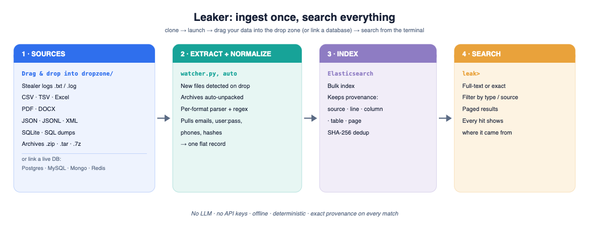
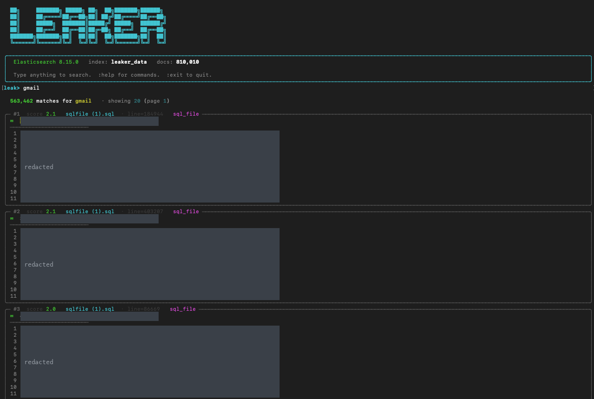

# Leaker

**Index your data once. Search all of it, instantly, from the terminal.**

## The problem it solves

This started with **stealer logs**. Infostealer malware (RedLine, Raccoon, Lumma and the like) infects a machine and quietly exfiltrates everything useful: saved browser passwords, cookies, autofill, crypto wallets and system details. The output is a "log", and these logs circulate in huge, messy dumps, usually plain text lines like `URL:username:password`, mixed in with combolists and leaked database exports. If you do threat intelligence or check your own exposure, the practical question is simple: *does this email, domain or credential appear anywhere in millions of these lines?* Answering it is painful, because the data arrives in dozens of inconsistent formats and no two dumps look alike.

You cannot just point a language model at this. A model hallucinates, costs money on every query, has to be fed the data (a serious problem when the data is stolen credentials), and still cannot tell you the exact file, line and column a match came from. The job needs the opposite of a best guess: results that are **exact, fast, offline and fully traceable**.

So Leaker does it with plain parsing. Each format has a small parser, and **regex** pulls the useful pieces out of each line (emails, `user:pass` pairs, phone numbers, hashes). Every value is then **normalized** into one flat record that carries its own provenance (source, line, column, table, page), and the records are bulk-indexed into Elasticsearch and de-duplicated by content hash. After that you can search any value across everything instantly, and every hit tells you exactly where it came from. No model, no API keys, no guessing.



### Live search

A real `leak` session against a live index of 810,010 records. Searching `gmail` returns **563,462 matches**, each shown as a card with its source file, line and type, and the matched term highlighted. The record fields are redacted in this screenshot because the indexed data is real.



> **No LLM. No API keys.** Pure parsers into Elasticsearch. Fast, offline, deterministic.
>
> <sub>Diagram reproducible via [`assets/make_diagram.py`](assets/make_diagram.py). The screenshot is a real session with record fields redacted.</sub>

---

## Setup

### 1. Install

```bash
git clone https://github.com/yourorg/Leaker.git
cd Leaker
python -m venv venv && source venv/bin/activate
pip install -r requirements.txt
```

### 2. Start Elasticsearch

```bash
docker compose up -d
```

Elasticsearch → `http://localhost:9200`
Kibana (optional UI) → `http://localhost:5601`

Default credentials: `elastic` / `changeme`
Change them in `.env` (copy from `.env.example`).

### 3. Make `leak` a system command

```bash
# Make the script executable (already done in repo)
chmod +x /path/to/Leaker/leak

# Option A — symlink into /usr/local/bin (recommended)
sudo ln -sf /path/to/Leaker/leak /usr/local/bin/leak

# Option B — add Leaker dir to your PATH
echo 'export PATH="$PATH:/path/to/Leaker"' >> ~/.bashrc
source ~/.bashrc

# Option C — alias
echo 'alias leak="python /path/to/Leaker/main.py"' >> ~/.bashrc
source ~/.bashrc
```

Now just type `leak` anywhere.

### 4. Index your data

```bash
# Files and directories
leak index data/breach.csv
leak index data/breach.csv data/users.db data/dump.sql
leak index /path/to/data/              # entire directory (recursive)
leak index "exports/**/*.csv"          # glob pattern

# Live PostgreSQL
leak index-db postgres --host localhost --db mydb --user postgres

# Live MySQL
leak index-db mysql --host localhost --db mydb --user root

# MongoDB
leak index-db mongo --uri mongodb://localhost:27017 --db mydb

# Redis
leak index-db redis --host localhost
```

### 5. Search

```bash
leak        # opens the interactive shell
```

---

## Interactive shell

Once inside `leak>`:

| Input | What happens |
|---|---|
| `alice@gmail.com` | Full-text search, all indexed sources |
| `@hotmail.com` | Partial match — finds every email at that domain |
| `555-867-5309` | Finds this phone number everywhere |
| `John Smith` | Multi-word search |
| `5f4dcc3b5aa765d61d8327` | Hash lookup |

### Session commands

| Command | Effect |
|---|---|
| `:exact` | Toggle exact-match mode on/off (default: fuzzy full-text) |
| `:type csv sqlite …` | Filter results to these source types |
| `:type` | Clear the type filter |
| `:size 50` | Set results per page (default: 20) |
| `:sources` | List all indexed sources and document counts |
| `:index <path> …` | Index new files without leaving the shell |
| `:help` | Show help |
| `:exit` / `q` / Ctrl-C | Quit |

The prompt reflects active filters:

```
EXACT type:csv,sqlite leak> alice@gmail.com
```

---

## Files

```
main.py        — entry point + interactive REPL
                 No args → opens the shell
                 Subcommands: index, index-db, sources, delete

functions.py   — all logic, eight sections:
                   1. Config          reads .env
                   2. LeakerRecord    dataclass: content + provenance
                   3. File extractors csv, txt, pdf, json/jsonl, xml,
                                      excel, sqlite, sql dump, docx
                   4. DB extractors   postgres, mysql, mongodb, redis
                   5. Auto-loader     dispatch by extension/dir/glob
                   6. Elasticsearch   client, index setup, bulk indexer
                   7. Search          full-text, exact, aggregations
                   8. Display         rich table, plain-text

leak           — shell script wrapper (chmod +x, then symlink to PATH)

docker-compose.yml — Elasticsearch + Kibana (single-node, local)
requirements.txt   — Python dependencies
.env.example       — environment variable template
examples/          — sample CSV / JSON / SQL files
tests/             — unit tests (no Elasticsearch required)
```

---

## Non-interactive commands

```bash
# Index files
leak index data/breach.csv data/users.db
leak index /data/ --no-progress

# Index a database
leak index-db postgres --host localhost --port 5432 --db mydb --user postgres
leak index-db mysql    --host localhost --db mydb --user root
leak index-db mongo    --uri mongodb://localhost:27017 --db mydb
leak index-db redis    --host localhost

# List indexed sources
leak sources

# Wipe the index
leak delete
leak delete --yes   # skip confirmation
```

---

## How the flow works

```
  leak  (no args)
    │
    ▼
  run_interactive()               ← main.py
    │
    ├─ connect: get_es_client()   ← functions.py §6
    ├─ show banner + doc count
    │
    └─ loop:
         read input
           │
           ├─ :cmd  →  mutate session state  (exact, type filter, size)
           │            OR  list_sources()   ← functions.py §7
           │            OR  index_records()  ← functions.py §6
           │
           └─ query →  count_hits()          ← functions.py §7
                    →  search()              ← functions.py §7
                    →  display_results()     ← functions.py §8
```

---

## Supported sources

### Files (auto-detected by extension)

| Extension(s) | What is indexed |
|---|---|
| `.csv` `.tsv` `.psv` | Per-cell + full-row; column name on every record |
| `.txt` `.log` | One record per non-empty line |
| `.pdf` | Text lines + table cells; page number on every hit |
| `.json` `.jsonl` `.ndjson` | Nested objects flattened to dotpath field names |
| `.xml` | Text nodes + attributes; XPath field names |
| `.xlsx` `.xls` `.ods` | All sheets; sheet name + row + column on every record |
| `.db` `.sqlite` `.sqlite3` | All tables, all rows, per-cell |
| `.sql` | Parses `INSERT` statements; falls back to line-by-line |
| `.docx` | Paragraphs + table cells |

### Live databases

| DB | Command |
|---|---|
| PostgreSQL | `leak index-db postgres` |
| MySQL / MariaDB | `leak index-db mysql` |
| MongoDB | `leak index-db mongo` |
| Redis | `leak index-db redis` |

---

## Elasticsearch index schema

Every indexed value is stored with its full provenance:

```
content      text   — the value (email_analyzer: emails stay as one token)
source       str    — file path or DB connection label
source_type  str    — csv | pdf | sqlite | postgres | …
line_number  int    — row / line (1-based)
column_name  str    — column or field name
table_name   str    — DB table, collection, or Excel sheet name
page_number  int    — PDF page number
doc_id       str    — SHA-256 (re-indexing same data = no duplicates)
```

---

## Adding a new format

1. Write an extractor in `functions.py` section 3:

```python
def extract_myformat(path: str) -> Generator[LeakerRecord, None, None]:
    for row_num, value in enumerate(your_parser(path), start=1):
        yield LeakerRecord(
            content=str(value),
            source=path,
            source_type="myformat",
            line_number=row_num,
        )
```

2. Register the extension in `EXTENSION_MAP` (section 5):

```python
".myfmt": extract_myformat,
```

Done — it works in the shell immediately.

---

## Running tests

```bash
pytest tests/ -v
```

No Elasticsearch or live database needed.

---

## License

MIT
